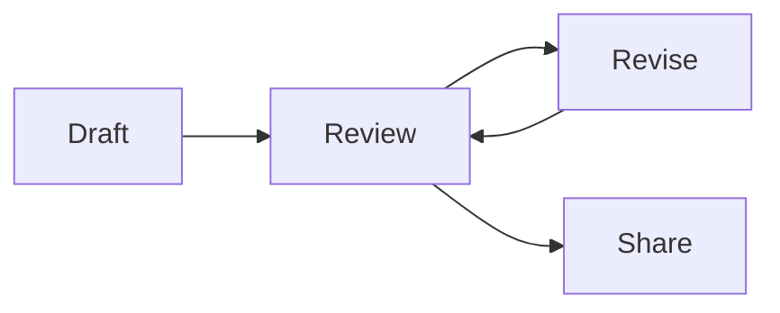

# Markdown examples

Use these patterns in source mode, then switch back to see the rendered result. The visual toolbar can create many of the same structures without typing their syntax.

## Headings and emphasis

```markdown
# Project notes

## Decisions

Use **bold** for emphasis, *italic* for a softer emphasis,
and `inline code` for names such as `config.json`.

### Next steps

Keep each section focused on one topic.
```

Use heading levels in order so the outline and exported table of contents remain easy to navigate.

## Lists and tasks

```markdown
- Project decisions
- Open questions

1. Write a draft
2. Review it
3. Share the result

- [x] Gather notes
- [ ] Edit the introduction
- [ ] Export the final document
```

Task lists are useful for a small checklist; ordered lists are useful when the sequence matters.

## Links, images, and quotes

```markdown
Read the [project overview](./overview.md).


> A useful quotation or a note you want to set apart.
```

Relative paths are resolved from the document's location. Keep images alongside the project, and give each image descriptive alternative text.

## Tables

```markdown
| Format | Best for | Editable text |
| :--- | :--- | :---: |
| Markdown | Continuing a draft | Yes |
| PDF | Sharing a finished layout | No |
| HTML | Reading in a browser | Yes |
```

The colons in the separator row set alignment. Prefer short cell content; wide tables are harder to read on smaller screens and printed pages.

## Code blocks

Wrap code in three backticks and add a language name for syntax highlighting.

````markdown
```javascript
const title = 'Project notes'
console.log(title)
```
````

Use fenced code blocks when spacing and line breaks matter. For a literal Markdown example, use an outer fence with four backticks, as this guide does above.

## Math

Mark2 supports inline and block math. Use inline math inside a sentence and a block for a standalone expression.

```markdown
The area is $A = \pi r^2$.

$$
E = mc^2
$$
```

Check the rendered formula before export. If it remains plain text or does not render, check the delimiters and the formula syntax.

## Mermaid diagrams

Use a fenced block labeled `mermaid`:

````markdown

````

Start with a short diagram and check that it renders in the editor. Diagram syntax errors need to be corrected before PDF or image export.

## Frontmatter

Some publishing tools use a YAML block at the start of a Markdown file:

```markdown
---
title: Project notes
tags:
  - writing
  - planning
---

# Project notes
```

Edit metadata in source mode. Frontmatter is metadata for tools that understand it; it is not a replacement for the visible document heading.

## Put the patterns together

````markdown
# Weekly review

## What changed

- Completed the first draft.
- Added a diagram to explain the process.

## Next actions

- [ ] Review the examples
- [ ] Export a PDF

## A useful reference

See [the plan](./plan.md).
````

Continue with [Editor basics](./editor) for editing controls or [Export documents](./export) to share the result.
