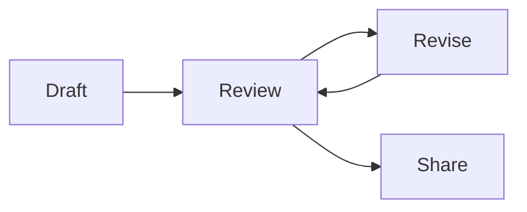

# Markdown 示例

在源码模式中输入或粘贴以下示例，再切回可视化模式查看结果。格式工具栏也可以创建多数常见结构，无需手动输入语法。

## 标题与强调

```markdown
# 项目笔记

## 决议

使用 **加粗** 强调重点，使用 *斜体* 表示较轻的强调，
使用 `行内代码` 标记 `config.json` 这样的名称。

### 后续步骤

每个章节围绕一个主题展开。
```

按顺序使用标题级别，有助于阅读大纲与导出的目录。

## 列表与任务

```markdown
- 一个相关要点
- 另一个相关要点

1. 编写初稿
2. 审阅内容
3. 分享文档

- [x] 收集资料
- [ ] 修改引言
- [ ] 导出最终文档
```

任务列表适合记录待办事项；有序列表适合强调操作顺序。

## 链接、图片与引用

```markdown
阅读[项目概览](./overview.md)。


> 引用内容，或需要单独展示的说明。
```

相对路径以文档所在位置为起点。将图片与项目一起保存，并为图片编写有意义的替代文本。

## 表格

```markdown
| 格式 | 适用场景 | 可编辑文本 |
| :--- | :--- | :---: |
| Markdown | 继续修改草稿 | 是 |
| PDF | 分享固定版式 | 否 |
| HTML | 在浏览器中阅读 | 是 |
```

分隔行中的冒号用于设置对齐。单元格内容应尽量简短，过宽的表格在小屏幕和打印页面上不便阅读。

## 代码块

使用三个反引号包围代码，添加语言名称以启用语法高亮。

````markdown
```javascript
const title = 'Project notes'
console.log(title)
```
````

需要保留空格与换行时，使用围栏代码块。展示包含三个反引号的 Markdown 示例时，外层可以使用四个反引号。

## 数学公式

Mark2 支持行内公式和块级公式。行内公式用于句子中，块级公式用于独立表达式。

```markdown
圆的面积为 $A = \pi r^2$。

$$
E = mc^2
$$
```

导出前检查公式是否正常渲染。如果显示为纯文本或无法渲染，检查分隔符与公式语法。

## Mermaid 图表

使用语言标记为 `mermaid` 的代码块：

````markdown

````

从简单图表开始，确认它能在编辑器中正常显示。导出 PDF 或图片前，需要先修正图表语法错误。

## Frontmatter

部分发布工具使用文档开头的 YAML 块保存元数据：

```markdown
---
title: 项目笔记
tags:
  - writing
  - planning
---

# 项目笔记
```

在源码模式中编辑元数据。Frontmatter 用于支持它的工具，不能代替页面中可见的文档标题。

## 组合示例

````markdown
# 每周回顾

## 本周进展

- 完成初稿。
- 添加流程图。

## 后续任务

- [ ] 检查示例
- [ ] 导出 PDF

## 参考资料

查看[项目计划](./plan.md)。
````

操作方式见[编辑器基础](./editor)，分享方式见[导出文档](./export)。
